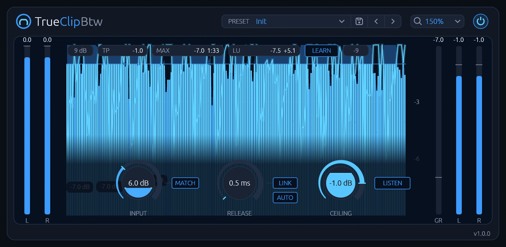

# TrueClipBtw

**A mastering clipper whose ceiling holds in true peak, with one dial from clip to limit.** Push a mix or a bus into
the ceiling and the output stops there, between the samples too. CLAP for Linux.



**[TrueClipBtw on jelly-comet.github.io](https://jelly-comet.github.io/plugins/trueclipbtw/)**: more screenshots, the manual to read or as a PDF, and every release.

TrueClipBtw goes last on a master or a bus. INPUT pushes the mix into a ceiling and the ceiling holds: the output's
true peak stops there, with no limiter to add behind it and no oversampling to choose. RELEASE is the one dial. At its
left end every peak is taken on its own, inside half a millisecond, as loud as a clip, and what rides on a clipped peak
(the hats over a kick) stays, where a clip cuts it away with the peak. Turned right, the gain takes up to 50 ms to come
back, the bass stays clean and it starts to ride like a limiter. MATCH turns the output down to the input's loudness,
so you compare what was taken and not the level, and LISTEN plays what was taken off. It doesn't saturate, warm or
"inflate": there is no curve to pick.

**[Read the manual](manual.md)** for every control and how to use it.

## What it's for

- **Mastering loudness:** push a finished mix louder into a −1 dBTP ceiling for streaming, with the true peak held.
- **Clipping drums:** shave the peaks off a drum bus or a kick and snare, keeping what rides on them.
- **A true-peak limiter:** RELEASE turned right with LINK on rides the level like a brickwall limiter.
- **Hitting a LUFS target:** LEARN sets INPUT so the loudest part plays at the loudness you aim at.
- **Hearing what clipping takes:** LISTEN plays only what is taken off, MATCH compares at the same loudness.

## Features

- **A ceiling in true peak that holds:** a mix pushed 6 and 12 dB into a −1 dBTP ceiling reads −0.999 to −1.000 dBTP on
  a BS.1770 meter, and −0.99 dB at worst read at 16 times the rate.
- **One dial from clip to limit:** RELEASE from 0.5 to 50 ms. At 0.5 ms a small tone riding a bass 6 dB over the
  ceiling keeps all but 3.1 dB, where a clip erases 9.5 dB of it; at 50 ms the bass stays clean. The clip end is 1.3 LU
  louder at the same INPUT.
- **AUTO:** a reduction that goes on, a bass held against the ceiling, comes back slowly, while a lone peak comes back
  at RELEASE's speed.
- **LU and LEARN:** LU reads the output's integrated loudness and how many LU louder it is than the input; LEARN sets
  INPUT round by round until the looping loudest part reads at AIM, −14 to −6 LUFS, within 0.3 LU.
- **MATCH:** the output at the input's loudness, within 0.03 LU, so you hear the damage and not the level.
- **LISTEN:** plays what the clipper takes off and shows its spectrum.
- **LINK:** one gain for both sides; off, each side is turned down only for its own peaks.
- **Readouts and a display:** TP, the output's true peak; MAX, the deepest reduction and when it happened; the last
  8 seconds of input, output and reduction with the ceiling across it, a line you can drag.
- **Latency:** 47 samples at 48 kHz (0.98 ms), the same at every setting, reported to the host.
- **Presets:** Init and four more along the dial, and your own; a preset never changes INPUT or MATCH.
- **Light:** 0.25 % of a CPU core pushed 6 dB, stereo at 48 kHz, and next to nothing on digital silence.
- **Zoom** from 100 to 200 %.
- **No network access and no telemetry.**

## Install

Download the latest version from the [Releases page](https://github.com/jelly-comet/TrueClipBtw-release/releases),
or with these commands:

```bash
curl -LO https://github.com/jelly-comet/TrueClipBtw-release/releases/download/v1.0.0/TrueClipBtw-1.0.0-linux-x86_64.tar.gz
curl -LO https://github.com/jelly-comet/TrueClipBtw-release/releases/download/v1.0.0/TrueClipBtw-1.0.0-linux-x86_64.tar.gz.sha256
sha256sum -c TrueClipBtw-1.0.0-linux-x86_64.tar.gz.sha256 && tar xzf TrueClipBtw-1.0.0-linux-x86_64.tar.gz
cd TrueClipBtw-1.0.0-linux-x86_64
```

Install for your user:

```bash
mkdir -p ~/.clap
rm -f ~/.clap/TrueClipBtw.clap && cp TrueClipBtw.clap ~/.clap/
```

Or for all users:

```bash
sudo mkdir -p /usr/lib/clap
sudo rm -f /usr/lib/clap/TrueClipBtw.clap && sudo cp TrueClipBtw.clap /usr/lib/clap/
```

Removing the old copy first avoids overwriting a file a running host has loaded. Then rescan plugins
in your DAW.

To uninstall:

```bash
rm -f ~/.clap/TrueClipBtw.clap
```

Your presets stay in `~/.local/share/TrueClipBtw/presets/`; delete that folder too if you want them gone.

## Requirements

- Linux x86-64 on a CPU with AVX2 (Intel Core from 2013, AMD from 2015), with glibc 2.31 or newer (Ubuntu 20.04, Debian 11, Fedora 32 and newer)
- A CLAP host. Tried in Bitwig Studio and REAPER.
- X11 or XWayland, and a Vulkan driver for the editor

Releases contain the CLAP plugin only.

## FAQ

### Is it free?

Yes. The download is free and MIT-licensed.

### Is there a VST3 or LV2 version?

No. Releases contain the CLAP plugin only.

### Does it run on ARM, like a Raspberry Pi or Apple Silicon?

No. It needs Linux on x86-64, on a CPU with AVX2.

### Which hosts does it work in?

Any CLAP host. It was tried in Bitwig Studio and REAPER.

### Does it work on Wayland?

Through XWayland. The editor also needs a Vulkan driver.

### Does it add saturation or warmth?

No. It only turns the level down where a peak would pass the ceiling, so under the ceiling the sound passes untouched.
There is no curve to pick and nothing to colour it.

## License

MIT, see [LICENSE](LICENSE). The licenses of the third-party code in the binaries are in
`THIRD-PARTY-LICENSES.txt` in each release archive.

VST is a registered trademark of Steinberg Media Technologies GmbH. CLAP is an open standard by the
free-audio project. FabFilter, Ableton and Orban are trademarks of their owners; the editor's layout borrows ideas from
FabFilter's and Ableton's and nothing else, and the clipper follows a patent of Orban's that has expired. TrueClipBtw is
an independent project, not affiliated with or endorsed by any of them.
