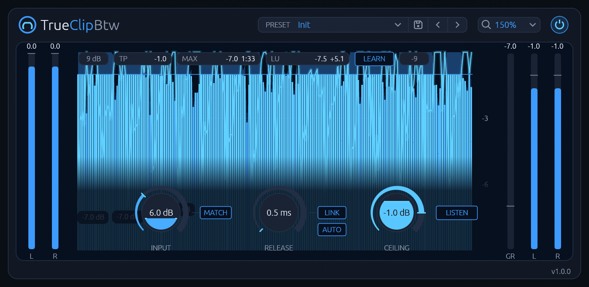
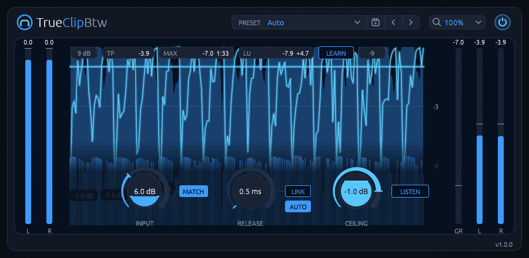
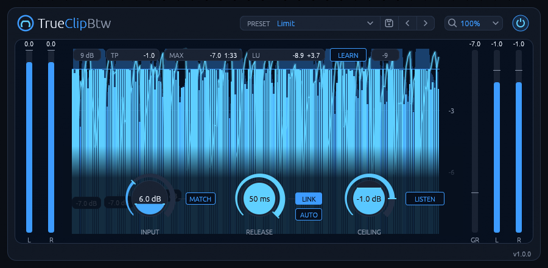
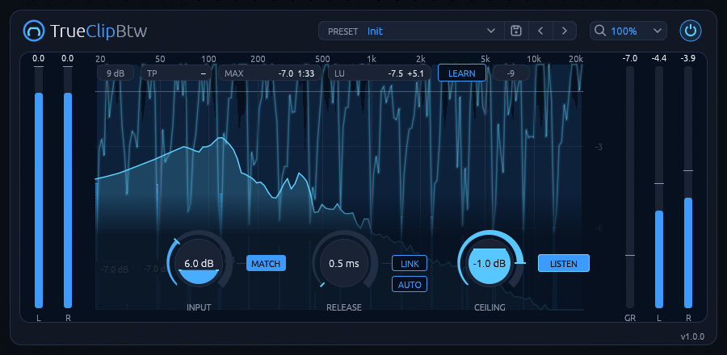

# TrueClipBtw manual

**A mastering clipper whose ceiling holds in true peak, with one dial from clip to limit.** Push a mix or a bus into
the ceiling and the output stops there, between the samples too.

Version 1.0.0. To install it, see the [install steps](README.md#install).

## Contents

- [Getting started](#getting-started)
- [The controls](#the-controls)
- [How to use it](#how-to-use-it)
- [Good to know](#good-to-know)
- [Troubleshooting](#troubleshooting)

## Getting started

Put TrueClipBtw last on your master or on a bus and play the loudest part. Turn INPUT up: the display shows the input
behind, the output in front and, from the top down, the reduction, and the output stops at the line across it, the
ceiling (−1 dBTP to start with). Switch MATCH on to hear the clipped sound at the input's loudness, so you judge what
was taken and not that it got louder; switch it off again before you bounce.

## The controls

From the top left of the window.

| Control | Range | Default | What it does |
| --- | --- | --- | --- |
| **PRESET** | a list | Init | See [Presets](#presets). |
| **Zoom** | 100 to 200 % | 100 % | The window's size, kept with the project. |
| **Power switch** (top right) | on, off | on | Off, the input passes untouched at the same latency, crossfaded over 20 ms. |
| **L, R** (meters at the left) | | | The input's level on each side, before INPUT. |
| **Display scale** (top left of the display) | 9, 18, 36 dB | 9 dB | How much reduction the display shows, kept with the project. |
| **TP** (readout) | | | The output's true peak since the last click. A click on TP, MAX or LU starts all three again. |
| **MAX** (readout) | | | The deepest reduction since the last click, and the song time it happened at (`–` when the transport wasn't playing). |
| **LU** (readout) | | | The output's integrated loudness since the last click, in LUFS, and how many LU louder it is than the input (MATCH aside). |
| **LEARN** | a switch | off | With the loudest part looping, sets INPUT until that part reads at AIM. |
| **AIM** | −14 to −6 LUFS | −9 | The loudness LEARN aims at, kept with the project. |
| **INPUT** | 0 to 18 dB | 0.0 dB | How hard the mix is pushed into the ceiling. |
| **MATCH** (off INPUT) | off, on | off | The output turned to the input's loudness. |
| **RELEASE** | 0.5 to 50 ms | 0.5 ms | How long the gain takes to come back: left clips, right limits. 5 ms sits at the knob's middle. |
| **LINK** (off RELEASE) | off, on | off | One gain for both sides; off, a gain for each. |
| **AUTO** (off RELEASE) | off, on | off | A reduction that goes on comes back slowly, over 50 ms; a lone peak at RELEASE's speed. |
| **CEILING** | −6 to 0 dB | −1.0 dB | Where the output's true peak stops, in dBTP. Also the line across the display: drag it. |
| **LISTEN** (off CEILING) | off, on | off | Plays what is taken off, and shows its spectrum. Closing the window switches it off. |
| **GR, L, R** (meters at the right) | | | The reduction now, and the output's level on each side. |

**Mouse:** drag a knob up or down; hold Shift for fine steps; the scroll wheel steps; double-click resets to the
default; right-click a value to type it, with a comma or a point. The ceiling's line drags the same way, Shift for fine
steps, and a double-click on it resets CEILING. A click on a meter's number starts its highest value again. The host can
automate every parameter; LISTEN and LEARN aren't parameters, and LEARN sets only INPUT.

## How to use it

### INPUT and CEILING

INPUT is how far the mix is pushed into the ceiling, and CEILING where the output's true peak stops. The true peak is
the level between the samples too, which a sample meter misses and a converter or a lossy encoder can still reach:
read on a BS.1770 meter, a mix pushed 6 and 12 dB into −1 dBTP comes out at −0.999 to −1.000 dBTP, and at −0.99 dB at
worst read finer still. −1 dBTP is the usual ceiling for streaming; nothing behind TrueClipBtw needs to catch peaks.

### RELEASE: from clip to limit

RELEASE sets how long the gain takes to come back after a peak.

- **At 0.5 ms (the left end)** each peak is taken on its own and the gain is back before the next: as loud as a clip,
  but what rides on a peak stays. A small tone riding a bass 6 dB over the ceiling keeps all but 3.1 dB of itself, where
  a clip erases 9.5 dB of it. A bass pushed hard gets a clip's edge, its third harmonic −14.5 dB.
- **Towards 50 ms (the right end)** the gain comes back slowly, the bass stays clean (its third harmonic −31.7 dB) and
  it rides the level like a limiter, 1.3 LU quieter at the same INPUT.

Start at the left for drums and loud masters, and move right as far as the bass needs.

### AUTO

AUTO takes some of both ends: a lone peak comes back at RELEASE's speed, but a reduction that goes on, a bass held
against the ceiling cycle after cycle, comes back slowly, over 50 ms. At 0.5 ms it leaves a held bass about as clean as
a 20 ms release and plays a little louder than that release. On drums alone it gains nothing: a kick's reduction lasts
long enough to charge it, so it reads like a slower release there.

### LINK

Off (the default), each side is turned down only for its own peaks, so a quiet side next to a loud one comes through
untouched. On, both sides get one gain, which keeps the stereo image exactly where it is: reach for it on a master
whose centre shouldn't move, and with a long RELEASE.

### MATCH and LISTEN: hearing what it does

Louder always sounds better, so compare at the same loudness. MATCH turns the output down to the input's loudness,
within 0.03 LU once it has listened for a second, so switching the power or moving RELEASE shows the difference and
not the level. It lags a fast move of INPUT by about a second: compare at a setting, not while you turn. MATCH is a
parameter, so a bounce with it on sounds as you heard it: switch it off for the master you want loud.

LISTEN plays only what is taken off, and shows its spectrum over the dimmed display: what you hear there is everything
the clipper changes, so move RELEASE, AUTO or INPUT while it is on to hear what each takes. With MATCH on, it is turned
down by the same gain as the clipped sound.

### LU, LEARN and AIM: a loudness target

LU reads the output's integrated loudness in LUFS since your last click, as a BS.1770 meter does, and how many LU
louder it is than the input. For a target: set AIM (−14 to −6 LUFS), loop the loudest part of the song, and click
LEARN. It sets INPUT a round of 3 seconds at a time until that part reads at AIM, within 0.3 LU, usually in two or
three rounds; the status line says how it goes. Moving INPUT or clicking LEARN again stops it. It aims the part that
loops, so a whole song with quieter parts integrates under AIM.

### The display and the readouts

The last 8 seconds: the input behind, the output in front, lit where it reaches the ceiling, and the reduction as a
line from the top with its deepest points tagged. If the reduction runs off the bottom, set the scale at the top left
to 18 or 36 dB. TP shows the output's true peak, which tells you the ceiling held (lower with MATCH on); MAX the deepest
reduction and when in the song it happened.

### Presets

The PRESET list holds Init, your favourites, the other built-in presets and then your own. The arrows step through
them, the disk saves the current settings under a name, and the list searches, stars and deletes your own. A preset
holds RELEASE, LINK, CEILING and AUTO, never INPUT, MATCH or the power, so a preset never makes your track jump in
level.

| Preset | RELEASE | LINK | CEILING | AUTO | For |
| --- | --- | --- | --- | --- | --- |
| Init | 0.5 ms | off | −1.0 dB | off | The clip end, as a start. |
| Edge | 1 ms | off | −1.0 dB | off | A little smoother than a clip. |
| Auto | 0.5 ms | off | −1.0 dB | on | Clip the drums, spare a held bass. |
| Ride | 5 ms | off | −1.0 dB | off | Halfway: clipping and riding. |
| Limit | 50 ms | on | −1.0 dB | off | A true-peak limiter. |

Your presets are text files in `~/.local/share/TrueClipBtw/presets/`, shared by every project.

## Good to know

- **Latency:** 47 samples at 48 kHz (0.98 ms), 44 at 44.1 kHz, 70 at 96 kHz and 115 at 192 kHz, the same at every
  setting, the power switch and LISTEN included. The host compensates it.
- **Under the ceiling nothing changes:** with nothing to take off, the output is the input, delayed, to the bit.
- **Mono or stereo.**
- **Light:** 0.25 % of a CPU core pushed 6 dB, stereo at 48 kHz, a little more with the window open or AUTO on, and
  next to nothing on digital silence with the window shut.
- **Click-free changes:** INPUT and MATCH glide over 20 ms, the power switch and LISTEN crossfade over 20 ms, and
  RELEASE and CEILING can be moved and automated while it plays.
- **TP reads at four times the rate,** as a BS.1770 meter does; the clipper itself reads finer, at eight times the rate
  at 44.1 and 48 kHz.

## Troubleshooting

- **The plugin doesn't show up:** check that the bundle is in `~/.clap` or `/usr/lib/clap`, then rescan plugins in your
  DAW. It needs a CPU with AVX2.
- **The editor window stays black or doesn't open:** check that a Vulkan driver is installed. The `vulkaninfo` tool
  from `vulkan-tools` should list your GPU.
- **It got quieter:** MATCH is on. It turns the output to the input's loudness for comparing; switch it off before you
  bounce the master you want loud.
- **TP reads under CEILING with MATCH on:** that is MATCH turning the output down; the clipper still stops at CEILING.
- **LEARN says AIM is out of reach:** INPUT ran to 18 dB (or down to 0) and the loop still read under (or over) AIM.
  Pick another AIM, or a louder (or quieter) part.
- **LEARN stopped:** INPUT was moved while it ran, or the window was closed. It needs the window open and the part
  playing.
- **MAX shows `–` for the time:** the host's transport wasn't playing when it happened.
- **The deepest reductions are tagged behind the knobs:** set the display's scale (top left) to 18 or 36 dB.
- **A preset doesn't show up in the menu:** its file must end in `.preset`, and its name can't be a built-in preset's.
  The editor reads the folder when it opens and after a save, so reopen it after adding files by hand.
